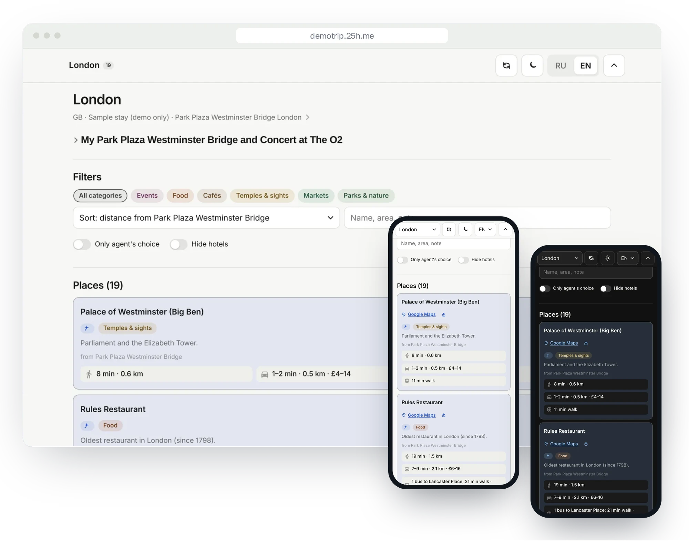

# PinKeepr

**Your saved places on one page. See what's near, wherever you stay.**

Your AI agent builds a trip page from your saved places and keeps it up to date as things change. A new base, a café you just found, a concert venue: say so, and the list re-sorts by travel time. Free to use, and the page is yours.

👉 **[Live demo: demotrip.25h.me](https://demotrip.25h.me/)**, a public instance of this template with made-up London data · About the project: [pinkeepr.25h.me](https://pinkeepr.25h.me/)



*The London demo. All data in it is made up.*

---

## What's on the page

- **Places.** Food, cafes, sights, parks, markets and more, each with a Google Maps link and your own note.
- **Travel times.** Walking, taxi and public transport from your starting point, so the list sorts by what is actually near.
- **Starting points.** A hotel, a friend's flat, an Airbnb, a station with a few hours between trains. A trip can have several, and the page switches between them.
- **Events.** Concerts, bookings and anything with a date, listed next to the places.
- **Made for a phone.** Light and dark theme, search and filters, works offline. Can be limited to people you list by email.

---

## You don't need to be technical

You won't install anything, write code, or edit files. **Your AI agent** (Claude Code, Codex, Cursor, or similar) does all of that for you. You just tell it what you want, in plain words.

### Step 1. Give your agent this message

Copy it as is:

```text
Set up my own travel site from https://github.com/mauzon/pinkeepr. Follow AGENTS.md end to end: fork to my account, deploy to my chosen host, load the London demo from https://github.com/mauzon/pinkeepr/tree/main/demo/london, keep trip data private, and maintain .travel/instance.json so you can manage the site later.
```

Don't want the demo? Change the end to **"deploy empty, no demo"**.

### Step 2. Answer a few questions

The agent will ask you to:

1. **Sign in to GitHub.** That's where your copy of the site lives. It's free, and it stays private.
2. **Pick a hosting service and sign in.** This is what puts your page on the internet. Cloudflare, Vercel, Netlify, or Railway all work. If you're not sure, pick Cloudflare.
3. **Decide who can open the page.** Anyone with the link, or only people whose email you list. Those people get a login code by email.
4. *(Optional)* **Use your own web address**, like `trips.yourname.com`.

### Step 3. Done

You get a link to your page. From then on, just tell the agent what to change. See the examples below.

---

## How it fits with the tools you already use

It doesn't replace Google Maps or the agent. Google Maps stays the source of places, the agent does the research and the edits, and the page is where the result ends up.

| | Saved list in Google Maps | Research in an agent chat | **PinKeepr page** |
|---|---|---|---|
| Where your places live | Pins and short notes | Spread across long chat threads | **One page that is always up to date** |
| Distance from your starting points | One route at a time | Only if you ask, per answer | **Ready for every place, from each starting point** |
| Structure | Flat list | Free text | **Categories, events, filters, search** |
| A week later | Still there, no context | Find the right chat and scroll | **Open the link; a new agent chat picks up from saved state** |
| Showing it to someone | Share the list | Screenshots or copied text | **Send a link, optionally email-gated** |

Things you can say to your agent:

> *"We're staying at a friend's flat now, measure from there."*
> *"We have five hours at Oriente station on the way back. Add it as a second starting point."*
> *"Drop the museums. Add two breakfast places near the station."*
> *"Sync my Google Maps list again."*

---

## Try the demo first

Not ready to add your own trip? Load a sample and see how the page works.

- **London**: 18 sights plus an example event. This is what's on the screenshot and at **[demotrip.25h.me](https://demotrip.25h.me/)**.
- **Lisbon** (`example`): a smaller sample trip.

Tell your agent:

```text
Load the London demo.
```

When you're ready for your real trip:

```text
Remove the demo data.
```

The demos use made-up data only, so they're safe to show anyone.

---

## Adding places from Google Maps

This is the quickest way to fill your page. If you already save places in Google Maps, you don't have to add them again one by one.

### Option A. Import a whole Google Maps list (best)

Works with your own lists and with **group lists your friends add places to**.

**1. Get the list link**

*On your phone (Google Maps app):*
1. Tap **You** (or **Saved**) at the bottom.
2. Open the list you want, for example "Lisbon 2027".
3. Tap **Share** (or **⋮ → Share list**).
4. If Google asks who can see the list, choose **anyone with the link**. Otherwise the agent can't read it.
5. Tap **Copy link**. You'll get something like `https://maps.app.goo.gl/AbC123xyz`.

*On a computer:* Google Maps → **Saved** → open the list → **Share** → turn on link sharing → **Copy link**.

**2. Send the link to your agent**

```text
Import my Google Maps list into the Lisbon trip:
https://maps.app.goo.gl/AbC123xyz
Use places within 30 km of the city center.
```

**3. What the agent does**

- Pulls in every place from the list, with its name, location, and Google Maps link.
- Keeps only the places near that city. One big list can cover several cities: each city just picks up its own places.
- Sorts places into categories (food, cafes, sights, parks, and so on).
- **Keeps your notes from Google Maps as they are.** The agent never overwrites them.
- **Opens the correct place in Maps** (CID / real `place_id` / your share link) — never a broken `place_id:/g/…` search.
- Works out travel times from your starting point to each place.
- Publishes the updated page.

**4. Added more places to the list later?**

Just say:

```text
Sync my Google Maps list again.
```

The agent adds the new places and shows you what changed. Your notes stay as they are.

**Good to know**

- The list link is saved only in **your private** copy of the project. Nobody else sees it.
- Your site keeps one "main" list that it can re-sync. You can import extra lists once with the same message. To re-sync another list later, just send its link again.
- If the agent says the list is empty or it can't open it, check the sharing setting from step 1.4.

### Option B. Add places one by one

Open a place in Google Maps, tap **Share → Copy link**, and send it to the agent:

```text
Add this restaurant to Lisbon, note "book a table": https://maps.app.goo.gl/XyZ789
```

You can send several links in one message.

### Option C. Set your starting point

This is where all distances and travel times are measured from. It doesn't have to be a hotel: it can be a friend's flat, an Airbnb, a train station where you change trains, a conference venue, anything. You can have several and switch between them on the page.

```text
In Lisbon we're staying at an Airbnb: https://maps.app.goo.gl/Flat123
Make it the main starting point.
```

```text
We have a 5-hour layover at Lisbon Oriente station. Add it as a second starting point.
```

You don't even need a link. A name or an address is enough, and the agent will find it.

---

## What else you can ask the agent

Write in normal sentences.

| You say | What happens |
|---|---|
| Load the London demo so I can see how it looks. | A sample London trip appears. |
| Add Borough Market to London as a market, note "go hungry". | The place appears in the right category with your note. |
| Add these five restaurants. | All of them are added under food. |
| The concert at The O2 is on 15 March 2027 at 7:30 pm. Add it as an event and a starting point. | The concert appears under events, and you also see distances from the venue. |
| Change Borough Market to the food category. | The place moves to that category. |
| Remove Borough Market. | The place is removed. |
| Make my hotel the default starting point. | Distances are measured from the hotel by default. |
| We moved to a friend's flat at Rua X 12. Use it instead of the hotel. | The new starting point replaces the old one, and all distances are recalculated. |
| Remove the whole Lisbon trip. | That city is removed from the page. |
| Remove the demo data. | The sample data is cleared. |
| Add my partner's email so they can open the site. | That person can now log in. |
| Run a security audit of my travel site. | The agent checks the site for privacy and security issues and tells you what to fix. |

**Place types:** sights, museums, parks, food, cafes, bars, markets, shopping, spa, nightlife, events, hotels, coworking, activities.

There's no "favourite" or "visited" button. Just ask the agent to add a note like "must visit" or "been there".

---

## How much it costs

Usually **nothing**, for a personal trip site. The only thing you pay for is the AI agent you already use.

- **This project:** free and open source (MIT), no subscription.
- **GitHub:** free, including private repositories.
- **Hosting:** the free plans at Cloudflare, Netlify and Vercel are enough for a personal trip site. Railway gives you trial credit.
- **Email login:** Cloudflare Access is free for a small group of people.

## Limits

- **No live co-editing.** Changes go through the repository, so two people editing at once may need their agents to sort out a conflict.
- **Not instant.** Edits go through a commit and a rebuild, so they show up after a minute or two.
- **No turn-by-turn navigation.** Each place opens in Google Maps.
- **You need** a GitHub account, a hosting account and access to an AI agent.

## Questions

**Do I need to know how to code?**
No. Your AI agent does the setup and every later change. You only sign in to GitHub and to a hosting service when it asks, and tell it what you want in plain words.

**Which AI agents work with it?**
Any agent that can work with a GitHub repository and run commands: Claude Code, Codex, Cursor and similar. The repository includes a runbook ([AGENTS.md](AGENTS.md)) the agent follows, so you don't have to explain the steps.

**Is it really free?**
The template is free and open source. GitHub and the free plans of Cloudflare, Vercel or Netlify are enough for a personal trip page. The only thing you pay for is the AI agent you already use.

**Who can see my page?**
Your choice. Anyone with the link, or only people whose email you list: they get a one-time login code. Your trip data stays in your own private repository.

**Do I need a Google Maps list?**
No. A shared list is the quickest start, but you can also send single Google Maps links, or just names and addresses, and the agent adds them.

**Can I have more than one starting point?**
Yes. A hotel, a friend's flat, a station during a layover, a concert venue. Add as many as you need and switch between them on the page; distances are recalculated for each.

**How accurate are the travel times?**
They are estimates: walking and driving times come from OpenStreetMap routing, taxi prices are approximate, and public transport is filled in where data is available. Each place has a Google Maps link for live directions.

**Does it work without internet?**
Once opened, the page keeps working offline: places, filters and notes are there. Google Maps links need a connection.

**Can several people edit it?**
Yes. Add them as collaborators to your GitHub repository. Their AI agents read the same runbook and saved setup, so anyone on the trip can ask their own agent for changes. Everyone else just opens the link.

---

## Updating your fork

If you forked pinkeepr a while ago, you can still pull in new template features (for example optional database storage) without starting over.

**Nothing is required** if your site already works the way you like. New releases are designed so the default stays “trip data in JSON files, static hosting” — no extra setup.

When you *do* want updates from the original template:

1. **Ask your agent** (or follow the steps below) to sync with `https://github.com/mauzon/pinkeepr`.
2. Because history on `main` was **squashed into one starting commit**, Git may say the histories are “unrelated”. That is normal for older forks.

**Simple path (recommended):** ask the agent to merge upstream:

```text
Update my pinkeepr fork from https://github.com/mauzon/pinkeepr main. If Git reports unrelated histories, use --allow-unrelated-histories and keep my trip data in data/cities/ and config.json.
```

**If you use git yourself** (technical):

```bash
git remote add upstream https://github.com/mauzon/pinkeepr.git   # once
git fetch upstream
git merge upstream/main --allow-unrelated-histories
```

Resolve any conflicts in `config.json` or your city files, then run `npm run validate && npm run build` and redeploy.

**Alternative:** clone a fresh copy of pinkeepr, copy your `data/cities/*.json` and `config.json` across, and point your host at the new repo.

What’s new is listed in **[CHANGELOG.md](CHANGELOG.md)**. Optional Cloudflare D1 + API is documented in **[DEPLOY-D1.md](DEPLOY-D1.md)** — only if you want live writes through an API instead of editing JSON in git.

---

## For developers

The full agent runbook (fork → deploy → domain → access → data → maintenance) is in **[AGENTS.md](AGENTS.md)**. It's the single source of truth, and the agent follows it.

**Quick start**

```bash
npm ci
npm run demo:london   # optional: load the London demo
npm run validate
npm run build         # static site → dist/
npm run test:browser  # optional Playwright smoke test
```

**Demo packs:** each pack is a folder with `pack.json` (manifest) and city JSON files. An agent can apply a pack straight from a GitHub link, without running scripts. Details: [`demo/README.md`](demo/README.md).

| Command | What it does |
|---|---|
| `npm run demo -- london` | Load `demo/london/` (18 sights + event) |
| `npm run demo -- example` | Load the Lisbon sample |
| `npm run demo -- <https-url>` | Load a pack from a GitHub tree/blob/raw URL |
| `npm run demo -- remove london` | Remove only that pack's files and cities |
| `npm run demo -- clear` | Clear all city data and reset config |
| `npm run demo:london` / `demo:clear` | Shortcuts |

A fresh clone has no trip data and builds an empty landing page until a pack or city is loaded.

**Deploy:** Node 22, build `npm ci && npm run build`, output `dist/`. The configs are already in the repo: `wrangler.jsonc` (Cloudflare Workers static assets), `vercel.json`, `netlify.toml`, `railway.json` + `serve.json` (Railway, `npm start`). Optional D1 + Worker API: `wrangler.d1.example.jsonc` and [DEPLOY-D1.md](DEPLOY-D1.md).

[](https://deploy.workers.cloudflare.com/?url=https://github.com/mauzon/pinkeepr)
[](https://railway.com/new/github)

**Where things live**

| Path | What it is |
|---|---|
| `config.json` | Site title, language, city list, `googleList`, optional `storage` (`json` default, or `d1`) |
| `data/cities/<slug>.json` | One city: origins, places, events, routes |
| `data/schema/` | JSON Schemas (city, pack, instance) |
| `demo/` | Demo packs (`london`, `example`), see [`demo/README.md`](demo/README.md) |
| `scripts/` | validate, demo, add-origin, enrich-routes, enrich-transit, extract/sync list, remove-*, audit |
| `src/` | React UI, `src/i18n/` for EN/RU strings |
| `.travel/instance.json` | Deployment state for the agent (gitignored, no secrets) |

**Google Maps list pipeline:** `scripts/extract-list.mjs <url>` → `scripts/filter-city.mjs` → `scripts/merge-city.mjs`; re-sync with `npm run sync-list` (dry run) / `-- --apply`. Places from a list get `source: "list"`, and `user_note` is never overwritten. Details: AGENTS.md Phase 5b.

**Maps links:** List imports capture feature ids → CID; the site never emits `place_id:/g/…`. See [docs/google-maps-links.md](docs/google-maps-links.md). Verify with `npm run check:maps-links`.

**Security:** CSP and headers live in `scripts/lib/security-headers.mjs`. `npm run audit:security` writes a report to `reports/`. Every external link must be https (checked by `validate`).

## Customization

**Icons & PWA:** default branding uses the suitcase emoji (🧳, U+1F9F3) from Twemoji, generated into `public/` (`favicon.svg`, `favicon.ico`, `apple-touch-icon.png`, `icon-192.png`, `icon-512.png`, maskable variant, `site.webmanifest`). Regenerate with `node scripts/generate-icons.mjs` (needs Python Pillow). `npm run build` copies `public/` into `dist/` and links icons in every HTML `<head>`. The top bar **Reload** button (iOS standalone PWA) clears Cache Storage and service workers, then reloads with a fresh `?v=` timestamp; HTML is served with `Cache-Control: no-cache`.

**Offline use:** `npm run build` emits `dist/sw.js` (versioned precache of all HTML routes, icons, manifest, and `data/cities/*.json`). After the first online visit, the installed PWA opens your place list, filters, and cards without a network. **Google Maps** links and map tiles still need the internet. On access-protected hosts (Cloudflare Access), if login redirects or 401/403 responses appear, the service worker serves the last cached HTML instead so the trip page still loads. Check with `npm run test:offline`.

## License

MIT, see [LICENSE](LICENSE).
